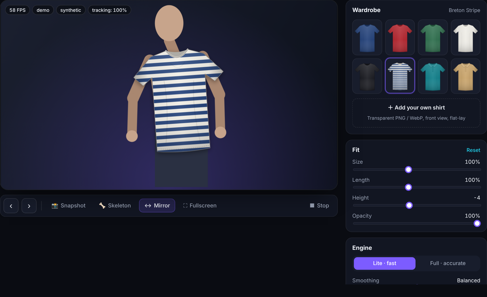

# TailorAI — Real-time Virtual Try-On

> A privacy-first virtual shirt try-on that runs **entirely in the browser**. Pose estimation locates your shoulders and hips, a One Euro filter stabilises the signal, and an affine model scales, rotates and stretches the garment to your body — live, at interactive frame rates, with no backend.

**Live demo:** _add your GitHub Pages URL here_ · **Stack:** JavaScript (ES modules) · MediaPipe Tasks Vision · Canvas 2D · PWA



## Features

| | |
|---|---|
| **Live webcam try-on** | 33-landmark pose tracking via MediaPipe PoseLandmarker (WASM + WebGL, CPU fallback) |
| **Stable, natural fit** | One Euro filtering removes jitter without adding lag; frame-rate-independent matrix smoothing |
| **Real garment geometry** | Affine fit maps the shirt's shoulder line *and* torso axis to the body: handles scale, rotation, lean and torso length |
| **Graceful degradation** | Hips out of frame → anatomical fallback ratio; tracking lost → shirt fades out; GPU unavailable → CPU |
| **Three input modes** | Webcam, animated demo mannequin (no camera needed), or upload a photo |
| **Bring your own garment** | Drag in a transparent PNG/WebP; borders are auto-trimmed, anchors inferred |
| **Studio tools** | Snapshot export, skeleton overlay, mirror, fullscreen, fit sliders, model selector (Lite / Full), smoothing presets |
| **Privacy by design** | No uploads, no server, no analytics. Frames never leave the device |
| **Installable PWA** | Manifest + service worker, works as a desktop/mobile app |
| **Tested core** | Pure-function geometry covered by Node's built-in test runner (12 tests) |

## How it works

```
 camera ─▶ canvas ─▶ PoseLandmarker ─▶ select anchors ─▶ One Euro filter ─▶ affine fit ─▶ draw
 (WebRTC)           (33 landmarks)    (shoulders, hips)   (per-point)      (js/fit.js)   (shadow, fade)
```

1. **Detect** — `js/pose.js` wraps MediaPipe's PoseLandmarker (`VIDEO` mode for streams, `IMAGE` mode for photos).
2. **Select anchors** — landmarks 11/12 (shoulders) and 23/24 (hips), ordered in *screen* space so mirroring never flips the garment. Hips are used only if visible and inside the frame.
3. **Stabilise** — each anchor passes through a [One Euro filter](https://gery.casiez.net/1euro/) (Casiez et al., CHI 2012): strong smoothing at rest, low latency in motion.
4. **Fit** — every garment declares two shoulder anchors and a hip line. `computeFit` builds the canvas matrix:

   ```js
   const sx = (shoulderWidth * size) / garmentSpan;                    // along the shoulder axis
   const sy = (shoulderWidth * torsoRatio * length) / garmentTorso;     // along the shoulder→hip axis
   matrix = [ux*sx, uy*sx,  dirX*sy, dirY*sy,  e, f];                   // rotate + scale + shear
   ```
5. **Render** — `ctx.setTransform(...matrix)`, soft drop shadow, opacity eased by a presence value so tracking loss never pops.

## Project structure

```
index.html            Landing page + studio UI
css/styles.css        Design system, responsive layout
js/main.js            App controller (sources, loop, UI wiring)
js/pose.js            MediaPipe PoseLandmarker wrapper
js/fit.js             Garment-fitting maths (pure, unit-tested)
js/filters.js         One Euro filter
js/draw.js            Canvas drawing (garment, skeleton)
js/demo.js            Synthetic pose + mannequin (demo mode, test fixture)
js/catalog.js         Catalog loading, custom garment ingestion
js/config.js          ← your name & links
assets/shirts/*.svg   Garments (generated by tools/generate_shirts.py)
assets/catalog.json   Garment metadata and anchors
tests/fit.test.js     Unit tests
sw.js, manifest.webmanifest   PWA
```

## Run locally

The camera API and ES modules need `http://localhost` (or HTTPS) — opening `index.html` via `file://` will not work.

```bash
cd tailorai
npm start            # = python3 -m http.server 8080
# open http://localhost:8080
npm test             # runs the unit tests (Node ≥ 18)
```

The pose model (~6 MB) is fetched from Google's CDN on first use and cached by the browser. To make the app fully self-hosted, download the `.task` file and the `@mediapipe/tasks-vision` package into the repo and point `MODELS` / `CDN` in `js/pose.js` at them.

## Deploy (free)

Push to GitHub, then enable **Settings → Pages → Source: GitHub Actions**. The included workflow (`.github/workflows/pages.yml`) runs the tests and publishes the site on every push to `main`. Netlify / Vercel / Cloudflare Pages also work with zero configuration (no build step).

## Adding garments

1. Draw/export a front-view flat-lay T-shirt as a transparent PNG, **or** add a style to `tools/generate_shirts.py` and run `npm run build:assets`.
2. In the app choose **Add your own shirt**, then adjust *Size / Length / Height* until it sits right.
3. To ship it permanently, add an entry to `assets/catalog.json` with its `anchors` (`sl`, `sr` = shoulder points, `hipY` = where the hips fall, in image pixels).

## Design decisions & trade-offs

- **Client-side only.** Removes server cost and privacy risk; the trade-off is that performance depends on the user's device (the Lite model is the default for that reason).
- **2D affine, not 3D mesh.** An affine fit is robust, fast and needs no body-shape model. It cannot drape fabric or model sleeves bending with the arms — see roadmap.
- **Pure-function core.** All geometry lives in `fit.js` with no DOM dependency, so it is deterministic and unit-testable.
- **Service worker uses stale-while-revalidate** for the app shell; bump `CACHE` in `sw.js` when you ship breaking changes.

## Roadmap

- Person segmentation to occlude the shirt with arms/hands crossing the torso
- Sleeve deformation following elbow landmarks (piecewise-affine mesh warp)
- Size recommendation from shoulder-to-hip proportions and a reference object
- Side-by-side before/after and shareable looks
- Multi-person support and rear-camera mode

## Credits & license

Concept inspired by the Computer Vision Zone "Virtual Try-On" tutorial (OpenCV + cvzone, desktop). This project is an independent re-implementation for the web with a different architecture: MediaPipe Tasks in the browser, One Euro filtering, an affine torso model, a test-suite and a PWA shell. Shirt illustrations are original, generated by `tools/generate_shirts.py`. Pose model © Google, Apache-2.0.

Code released under the [MIT License](LICENSE).
